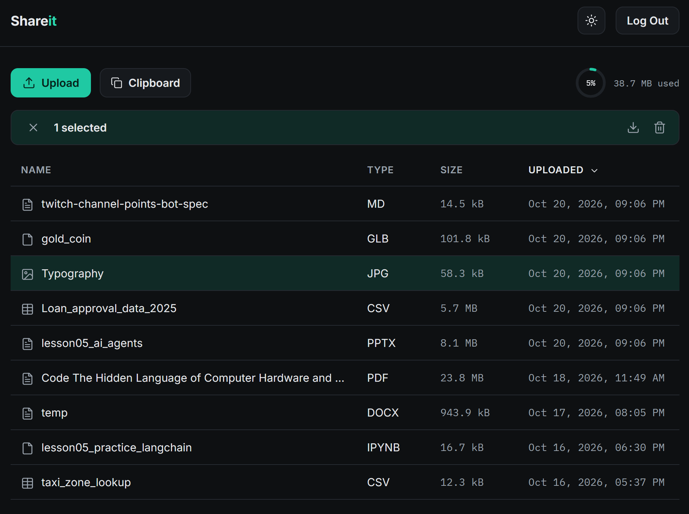
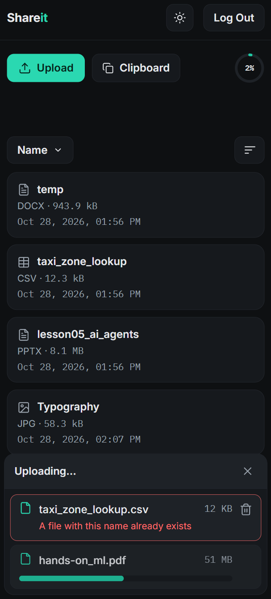
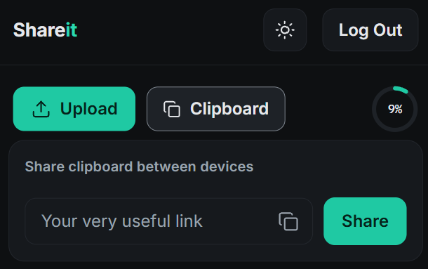

# Shareit

A self-hosted, single-user personal file-sharing app and cross-device shared clipboard.

Upload a file from one device, download it later on another. Paste a snippet on
your phone, read it on your laptop. Your files live on your server, not somebody
else's cloud.

Built with FastAPI + SQLite + HTMX, packaged in Docker, deployed behind Caddy
(auto-HTTPS). The backend serves both a JSON REST API (for `/docs` and future
native clients) and a server-rendered web UI from the same codebase.

## Screenshots

<p align="center">
  
  &nbsp;&nbsp;
  
</p>

<p align="center">
  
</p>

## Features

- Upload any file type (any size up to the configured per-file cap, default 5 GiB).
- Resumable chunked uploads for files over 10 MB, with SHA-256 verification on finalize.
- Multi-file upload with per-file progress and sequential queueing.
- File list with name, type, size, upload time, keyset-paginated and server-sorted.
- Download, delete, and bulk delete.
- Storage quota display (donut) and enforcement.
- Cross-device shared clipboard: one latest snippet, pulled explicitly.
- Password + JWT auth (access + refresh tokens), bcrypt-hashed credentials,
  silent cookie refresh for the web UI.
- Responsive web UI: desktop table + mobile cards, light/dark theme toggle.
- Background reaper for abandoned chunked uploads (reclaims reserved quota).

## Tech stack

- **Backend:** Python 3.12, FastAPI, SQLAlchemy 2.0, SQLite (Postgres-ready).
- **Frontend:** Jinja2 + HTMX + minimal vanilla JS, served from the same app.
- **Auth:** PyJWT (HS256), bcrypt.
- **Packaging:** Docker, Docker Compose.
- **Edge/TLS:** Caddy (auto Let's Encrypt).

## Project layout

```
app/
  main.py           FastAPI app, startup, middlewares, lifespan reaper
  config.py         Settings (reads env + .env)
  database.py       SQLAlchemy engine/session/Base
  models.py         ORM models (User, File, Upload, Clipboard)
  schemas.py        Pydantic request/response schemas
  security.py       Password hashing, JWT, get_current_user
  services.py       Shared business logic (used by both JSON and web routers)
  icons.py          Jinja filter + global for inline SVG icons
  routers/
    auth.py         register / login / refresh
    files.py        JSON: upload / list / download / delete
    uploads.py      JSON: resumable chunked uploads (manifest / chunk / resume / finalize)
    clipboard.py    JSON: get / set clipboard
    web.py          Web UI (cookie auth)
  templates/        Jinja2 templates + HTMX partials
  static/           Stylesheet (design tokens, light/dark)
Dockerfile
docker-compose.yml  App + Caddy
Caddyfile           Reverse proxy, auto-HTTPS, body-size cap
requirements.txt
inspect_db.py       Dev helper: dumps the files table
```

## Quick start — local development

Requires Python 3.12+.

```bash
git clone https://github.com/<you>/shareit.git
cd shareit

python -m venv .venv
# Linux / macOS:
source .venv/bin/activate
# Windows PowerShell:
.\.venv\Scripts\Activate.ps1

pip install -r requirements.txt

# Generate a secret and seed .env (first time only)
python -c "import secrets; print('SECRET_KEY=' + secrets.token_hex(32))" > .env

uvicorn app.main:app --reload
```

Then:

- Open <http://localhost:8000/> — the web UI (redirects to `/register` on first
  run, `/login` afterwards).
- Open <http://localhost:8000/docs> — Swagger UI for the JSON API.

### First run: register

Shareit is single-user. The very first thing you do is register, which also
logs you in. Open the web UI and you'll land on the `/register` page: choose a
password (at least 8 characters) and confirm it.

Or register through the API:

```bash
curl -X POST http://localhost:8000/auth/register \
  -H "Content-Type: application/json" \
  -d '{"password": "your-strong-password"}'
```

Once a user exists, registration is closed: `/register` redirects to `/login`
and `POST /auth/register` refuses further registrations (409).

> **Deploying publicly?** Register *immediately* after bringing the service up.
> Until a user exists, `/register` and `POST /auth/register` are open to anyone
> who reaches your URL.

## Docker

Local or VPS, same two commands:

```bash
# Create your .env first (SECRET_KEY required)
docker compose up -d --build

# Logs
docker compose logs -f app     # or caddy
```

The app runs non-root inside the container. Uploaded files and the SQLite DB
persist in the named `shareit_data` volume (mounted at `/app/data`), so they
survive container rebuilds and redeploys.

Caddy owns ports 80/443 on the host and reverse-proxies to the app on the
internal Docker network. The app's port 8000 is only published on `127.0.0.1`
for local testing — it is **not** exposed to the public internet.

## Deployment

The reference setup is a small VPS behind a free DuckDNS domain, with Caddy
provisioning HTTPS automatically. Any name you control works — a DuckDNS
subdomain is the cheapest option.

Rough recipe:

1. Point a domain (e.g. `yourname.duckdns.org`) at your VPS's public IP.
2. Install Docker and the Compose plugin on the VPS.
3. Open ports 80 and 443 on the firewall. (`ufw allow OpenSSH` first — don't
   lock yourself out.)
4. Clone this repo on the VPS. For a private deploy, a GitHub read-only
   **deploy key** over SSH is simpler than a personal token.
5. Create `.env` on the VPS (new `SECRET_KEY`, do not reuse the one from local).
6. Edit `Caddyfile`: replace `your-domain.example.com` with your real hostname.
7. `docker compose up -d --build`.
8. Register your single user immediately (see above).

Future redeploys: `git pull && docker compose up -d --build`.

### Edge body-size limit

`Caddyfile` caps request bodies at 6 GB (keeps headroom above the app's 5 GB
per-file default). The app enforces precise per-user quota and size checks
internally — Caddy's limit is a coarse DoS filter, not a replacement.

## Configuration

All settings are read from environment variables (and from `.env` locally).
Only `SECRET_KEY` is required; everything else has a sensible default.
See [`.env.example`](.env.example) for the complete list with inline
documentation.

Key knobs:

| Setting                           | Default                       | What it does                                  |
| --------------------------------- | ----------------------------- | --------------------------------------------- |
| `SECRET_KEY`                      | *(required)*                  | JWT signing secret.                           |
| `STORAGE_DIR`                     | `./data/storage`              | Where uploaded bytes live.                    |
| `STORAGE_LIMIT`                   | *(all disk)*                  | Total quota in bytes.                         |
| `MAX_UPLOAD_SIZE`                 | 5 GiB                         | Per-file cap.                                 |
| `PENDING_UPLOADS_DIR`             | `./data/uploads`              | Parts of in-progress chunked uploads.         |
| `DATABASE_URL`                    | `sqlite:///./data/shareit.db` | SQLAlchemy URL.                               |
| `ACCESS_TOKEN_EXPIRE_MINUTES`     | 15                            | Access token lifetime.                        |
| `REFRESH_TOKEN_EXPIRE_DAYS`       | 7                             | Refresh token lifetime.                       |
| `UPLOAD_STALE_AFTER_SECONDS`      | 3600                          | Idle time before a chunked upload is reaped.  |
| `PERIODIC_REAP_INTERVAL_SECONDS`  | 43200 (12 h)                  | How often the reaper runs.                    |

## Inspecting the database

A tiny helper dumps the files table:

```bash
python inspect_db.py
```

## Limitations and known gaps

- **No automated test suite yet.** Verify changes manually via `/docs` or
  the web UI.
- **No database migrations yet** (Alembic is on the roadmap). Model changes
  against an existing DB currently need manual handling.
- **Resumable uploads survive mid-session network drops only** — not a full
  page refresh or browser restart (the browser can't re-read a file without
  re-picking it).
- **Clipboard "Share"** uses `navigator.clipboard.readText()`,
  which Firefox and iOS Safari do not support. Falls back softly.
- **Single-user.** Multi-user support is a planned evolution (see Roadmap).

## Roadmap

The next major direction is evolving Shareit into a multi-tenant service:
spaces + membership + roles, Alembic migrations, a managed OIDC identity
provider, object storage (R2/S3) via presigned URLs, and tiered subscriptions.
This README will stay the "single-user self-hosted" entry point even then.

## Contributing

Bug reports and pull requests welcome. There is no test suite yet, so please
describe how you verified your change.

## License

[Apache License 2.0](LICENSE). © 2026 Nikita Vasilkov.
